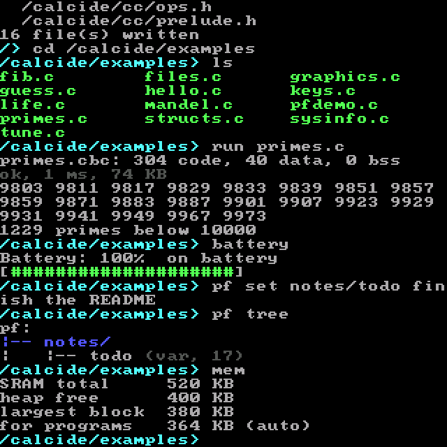
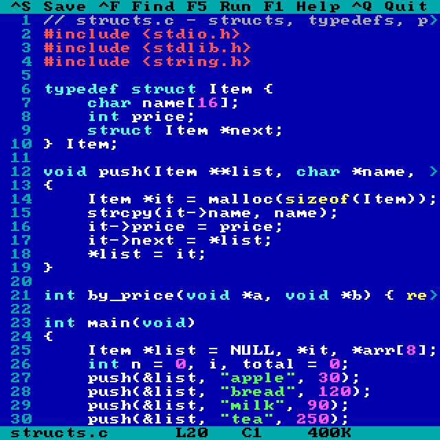
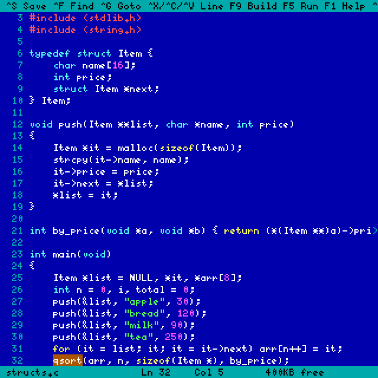
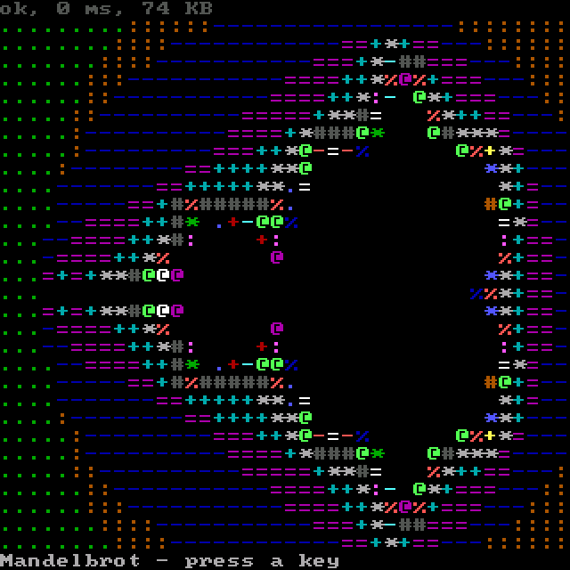
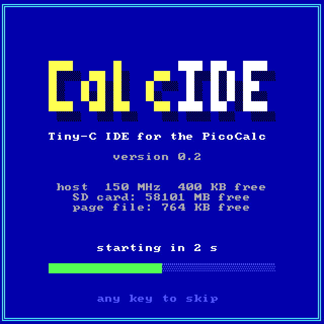

# CalcIDE 0.33

**A self-hosting C IDE for the ClockworkPi PicoCalc.** It boots into a DOS-style command line. From there you write, edit, compile and run C entirely on the PicoCalc, with no PC involved. Source, compiler and programs all live on the SD card.

## Credits

CalcIDE builds on these projects:

| Project | Used for |
|---|---|
| [INSCCOIN/CalcOS](https://github.com/INSCCOIN/CalcOS) | The LCD, keyboard and SD-card drivers (adapted), the flash STORE design that became `pf`, the boot-time safe mode and the sound code. |
| [clockworkpi/PicoCalc](https://github.com/clockworkpi/PicoCalc) | Hardware reference: pin map, ST7365P init sequence, keyboard-controller registers (`picocalc_keyboard/reg.h`), battery and power-off protocol, and the SD boot launcher (`pico_multi_booter`) memory layout. |
| [raspberrypi/pico-sdk](https://github.com/raspberrypi/pico-sdk) | The SDK the firmware is built on (BSD-3-Clause). |
| [FatFs by ChaN](https://elm-chan.org/fsw/ff/), via [zephyrproject-rtos/fatfs](https://github.com/zephyrproject-rtos/fatfs) | The FAT12/16/32 and exFAT file system with long file names (FatFs licence, in `lib/fatfs`). |
| [dhepper/font8x8](https://github.com/dhepper/font8x8) | The IBM PC style 8×8 glyphs behind the 8×10 MS-DOS font (public domain). |
| X11 misc-fixed `5x8` by Markus Kuhn | The glyphs behind the 5×10 font for 64-column mode (public domain). |

Everything else is new: the Tiny-C compiler, the bytecode VM, the shell, the editor, the console, the page file and the tests. It is MIT licensed, like CalcOS.

---

 

 

## New in 0.33: a little synthesizer

`play` is now a 4-channel synthesizer mixed in software at 16 kHz.

- **Several channels at once:** separate them with `|`.
- **Instruments:** five waveforms: `ISQ` square, `IPLS` pulse, `ITRI` triangle, `ISAW` saw, `ISIN` sine. Each channel has its own volume (`V0`–`V9`).
- **Drums:** a synthesized kit (no samples needed): `K` kick, `SN` snare, `HH` closed and `OH` open hi-hat, `CP` clap, `TH`/`TL` high and low tom, `CY` crash.
- **Repeats:** `[ ... ]x4`, and they nest.
- **Song files:** `.song` files hold one line per channel (`1:` to `4:`). Play one with `play FILE.song` or `play("@/path.song")` from C.

```
play T128 IPLS L8 [E5 G5 A5 G5]x2 | ITRI V9 A2/2 F2/2 | [K HH SN HH]x2
```

**[SONGS.md](SONGS.md) is the full guide to playing and writing songs**, with a step-by-step song-writing demo and a C demo (`jukebox.c`).

`install` puts twelve songs in `/calcide/songs/`:

| Song | What it tests |
|---|---|
| `demo.song` | every instrument, then every drum (start here) |
| `sunrise.song` | the tutorial song built step by step in SONGS.md (0:36) |
| `beat.song` | drums only: rock, funk, claps, a tom fill |
| `ode.song` | Ode to Joy: melody, bass and drums |
| `furelise.song` | Für Elise: two triangle-wave "hands" |
| `canon.song` | Pachelbel's Canon: three voices entering one by one |
| `chiptune.song` | an original 4-channel chiptune with arpeggios |
| `lavalamp.song` | *Lava Lamp Dream*: a 70s psychedelic E dorian vamp with organ and saw-wave lead (1:20) |
| `tangerine.song` | *Tangerine Sitar*: a raga in D phrygian dominant over a drone, with tom "tabla" (1:18) |
| `velvetfuzz.song` | *Velvet Fuzz*: a heavy A minor riff, organ verse and a pentatonic solo (1:20) |
| `caravan.song` | *Cosmic Caravan*: a G mixolydian groove with sine "flute" and wah stabs (1:23) |
| `mandala.song` | *Electric Mandala*: F lydian; it floats, builds into a groove, then drifts away (1:20) |

`tools/songcheck.py` checks that a song's channels are all the same length. `examples/drums.c` plays melody, bass and drums from C, and `examples/jukebox.c` builds tunes at run time, turns the keyboard into a drum pad and plays song files from a menu.

## New in 0.3

- **Melodies:** `play("T140 C4 E4 G4/2 R C5")` from C, or the `play` command. Notes, sharps and flats, octaves, lengths, dotted notes, rests, tempo.
- **WAV playback:** `play_wav("song.wav")` or the `wav` command. 8- and 16-bit PCM, mono or stereo, up to 48 kHz, through the speakers.
- **GPIO and UART for hardware projects:** `gpio_mode`, `gpio_write`, `gpio_read`, and `uart_open`, `uart_putc`, `uart_getc`, `uart_puts` and friends. UART0 is on GP0/GP1 and UART1 on GP4/GP5. The pins the PicoCalc itself uses are refused, so a program can't break the screen, keyboard or SD card. There's also a `gpio` command, plus `blink.c` and `serial.c` examples.
- **Command history is saved** to `/calcide/history.txt` (at most 16 KB, oldest commands dropped first), so Up-arrow works across restarts.
- **`selftest`:** checks memory, the SD card (read, write and speed), the page file, the compiler and VM end to end, battery, temperature and clock. It then asks you to confirm the screen, a key press and the speaker. `selftest quick` skips the questions.

## New in 0.2

- **64-bit `double` and `long long`.** `float` stays 32-bit and fast; `double` is a true IEEE double, so `printf("%.15f")` means what it says.
- **More C:** variadic functions of your own (`<stdarg.h>`, `vprintf` and friends), `setjmp`/`longjmp`, `#` stringizing in macros, designated initializers (`.x = 1`, `[3] = 5`) and compound literals (`(struct pt){1, 2}`).
- **Better compile errors:** each error shows the line with a caret under the column, and up to 10 errors are reported per compile instead of just the first.
- **A faster VM:** computed-goto dispatch, plus fused instructions for compare-and-branch, store-and-discard and global loads.
- **Several files open in the editor** as tabs (F6/F7 to switch, Ctrl+W to close; `max_files` sets the limit), and **auto-closing** brackets and quotes.
- **New settings:** `cpu_mhz_idle` and `cpu_mhz_run` (a slow clock at the prompt, a fast one while compiling and running), a boot screen (`splash`, `splash_ms`, `splash_image` for your own `.bmp`), `break_key`, `show_stats`, `auto_close` and `max_files`.



## Contents

- [What's in it](#whats-in-it)
- [Downloads and flashing](#downloads-and-flashing)
- [First boot](#first-boot)
- [Quick start](#quick-start)
- [The display](#the-display)
- [The editor](#the-editor)
- [Settings: CalcIDE.conf](#settings-calcideconf)
- [The page file](#the-page-file)
- [Memory](#memory)
- [Building](#building)
- [Tests](#tests)
- [Troubleshooting](#troubleshooting)
- [Project layout](#project-layout)

The full command reference is in **[commands.md](commands.md)**. The C dialect, built-in library and VM are covered in **[compiler.md](compiler.md)**. Playing and writing music is covered in **[SONGS.md](SONGS.md)**.

## What's in it

- **A shell** with 48 commands, plus DOS and Linux synonyms (`dir`/`ls`, `del`/`rm`, `type`/`cat`, ...), for 64 command names in all. These include the system commands you asked for (`battery`, `shutdown`, `reset`, `width`, `cls`, `color`/`theme`, `font`, `cursor`, `beep`, `mute`, `df`, `tree`, `sd`, `mount`/`unmount`, `sync`, `mem`/`free`, `uptime`, `version`, `temp`, `clock`, `exit`, `bye`, `history`, `alias`, `help`) and Linux/DOS-style file commands (`ls`/`dir`, `cd`, `mkdir`, `rm`, `cp`, `mv`, `cat`, `more`, ...). The shell also has command history, tab completion and aliases.
- **A full-screen editor** with line numbers, syntax colouring (keywords, types, strings, comments, numbers, preprocessor), auto-indent, auto-closing brackets and quotes, Ctrl+F search, go-to-line, line cut/copy/paste, several files open as tabs, and a status line showing the file name, cursor position and free memory in KB. **F5** compiles and runs; a compile error jumps straight to the offending line, opening the right file if the error is in a header.
- **A C compiler** (Tiny-C dialect, closer to "most of C") that runs on the RP2350. It handles `char`, `short`, `int`, `long`, 64-bit `long long`, `unsigned`, 32-bit `float` and 64-bit `double`, structs, unions, enums, typedefs, pointers to pointers, function pointers, arrays (multi-dimensional too), designated initializers, compound literals, variadic functions, `malloc`/`free`, `setjmp`/`longjmp`, `switch`, `goto`, `static`, and a real preprocessor with `#include`, `#define` (with parameters and `#` stringizing), `#if`/`#ifdef`/`#elif`. Comments can be `//`, `/* */` or `##`. Compile errors show the line with a caret, and up to 10 are reported at once.
- **It is self-hosting.** The compiler is written in the dialect it accepts. Compiled by itself and run on the VM, it produces a byte-identical copy of itself. The test suite checks this on every run.
- **A bytecode VM** with runtime checks. It catches null pointers, out-of-bounds memory access, stack overflow, division by zero, bad `free()`, and calls through null function pointers. Errors report the function and source line, and Ctrl+C breaks out of any program.
- **167 built-in functions**: stdio (including files on the SD card), string, ctype, stdlib, math, and PicoCalc hardware (screen, colours, keyboard, sound, melodies, WAV files, GPIO, UART, backlight, battery, CPU speed, temperature, pixels, and the page file).
- **A page file (`pf`)**: 768 KB of on-board flash for named objects. It stores text, data and even programs, which can run straight from flash. The design follows CalcOS's STORE.
- **All settings live in `/CalcIDE.conf`** in the root of the SD card: colours (shell and editor syntax colours), width/font, cursor, sound, backlight, idle and run clock speeds, boot screen, break key, memory sizes, prompt, autoexec and aliases.

## Downloads and flashing

Everything is in `dist/`:

| File | For |
|---|---|
| `calcide-0.33-rp2350.uf2` | PicoCalc with a **Raspberry Pi Pico 2 / Pico 2 W** (RP2350), stand-alone |
| `calcide-0.33-rp2040.uf2` | PicoCalc with a **Raspberry Pi Pico / Pico W** (RP2040), stand-alone |
| `calcide-0.33-rp2350-sdboot.bin` | RP2350 app for the PicoCalc **SD boot launcher** (`pico_multi_booter`) |
| `calcide-0.33-rp2040-sdboot.bin` | RP2040 app for the SD boot launcher |
| `calcide-0.33.zip` | Everything above plus the full source and documentation |

**Stand-alone:** hold BOOTSEL on the Pico, plug in USB, and copy the `.uf2` onto the drive that appears. From a running CalcIDE, the `bootsel` command does the same without opening the case.

**From the PicoCalc launcher:** copy the `-sdboot.bin` into the launcher's apps folder on the SD card and pick it from the menu. `exit` restarts the Pico, which brings you back to the launcher menu.

The RP2350 is the main target. The RP2040 build has the same features, but it has half the RAM: programs get about 150 KB instead of about 400 KB, and the compiler cannot compile its own (large) source there.

## First boot

1. Put a FAT32 (or exFAT/FAT16) formatted SD card in the PicoCalc and switch on.
2. CalcIDE creates `/CalcIDE.conf` with default settings and shows the banner.
3. Type **`install`**. This writes the example programs to `/calcide/examples/` and the compiler's own source to `/calcide/cc/`. Both are built into the firmware.
4. Type `cd /calcide/examples`, then `run hello.c`.

Holding **Esc** while switching on starts in safe mode, which skips the saved CPU clock and the `autoexec` command.

The console is mirrored to **USB serial** at any baud rate (`/dev/ttyACM0`, or a COM port). That terminal can also type into CalcIDE, so the arrow keys work there too.

## Quick start

```
/> cd /calcide/examples
/calcide/examples> edit hello.c        (F5 = compile and run, Esc = quit)
/calcide/examples> run fib.c           (compiles if needed, then runs)
/calcide/examples> cc primes.c         (compile only: writes primes.cbc)
/calcide/examples> primes              (run a .cbc by name, like DOS)
/calcide/examples> run pfdemo.c        (a program that keeps data in flash)
```

To self-host the compiler on the device:

```
/> cc /calcide/cc/cc.c -o /bin/cc.cbc      (native compiler builds the VM compiler; 'install' made /bin)
/> run /bin/cc.cbc hello.c -o hello.cbc    (the VM compiler, written in Tiny-C, compiles)
/> run hello.cbc
```

## The display

The panel is 320×320 pixels. CalcIDE uses 32 rows of 10-pixel text in two modes:

| Mode | Font | Grid | Why |
|---|---|---|---|
| `width 40` | 8×10 (IBM PC style, MS-DOS look) | **40 × 32** | 320 / 8 = 40 |
| `width 64` | 5×10 (X11 fixed 5×8) | **64 × 32** | 320 / 5 = 64, the narrowest legible glyph |

`font 8x10` and `font 5x10` are the same switch, seen from the font side. Both fonts include the CP437 shade, box-drawing and block characters (0xB0–0xDF), so programs can draw DOS-style frames.

There are 16 colours with the CGA/DOS palette, and the console understands ANSI escape sequences (colours, cursor movement, clearing). Programs written for a VT100 or ANSI.SYS display correctly.

## The editor

`edit FILE` opens the editor. If the file doesn't exist yet, it starts empty. `edit a.c b.h c.c` opens each file in a tab of its own. With more than one file open, the top row becomes a tab strip (`1:a.c* 2:b.h`), and `*` marks unsaved changes.

| Key | Action |
|---|---|
| Arrows, Home, End, PgUp, PgDn | move (Home toggles first non-blank / column 0) |
| Ctrl+T | jump to top / bottom |
| Ctrl+G | go to line |
| **Ctrl+F** | find (case-insensitive); **F3** or Ctrl+N finds the next |
| Ctrl+S | save |
| Ctrl+O | open a file in a new tab (or switch to it if it's open) |
| **F6 / F7** | previous / next tab |
| Ctrl+W | close the tab (asks to save) |
| Ctrl+X / Ctrl+C / Ctrl+V | cut / copy / paste line |
| Ctrl+D | duplicate line; Ctrl+K deletes the line |
| Tab | indent to the next tab stop (spaces) |
| `(` `[` `{` `"` `'` | with `auto_close` on, the closing half is inserted too; typing the closer steps over it, Backspace in an empty pair deletes both, and Enter between `{}` opens an indented block |
| **F9** / Ctrl+B | compile; on an error the cursor jumps to the line |
| **F5** / Ctrl+R | save, compile and run |
| F1 | help |
| Esc / Ctrl+Q | quit the editor (asks to save each modified file) |

Rows 1–30 hold text, row 0 shows key hints, and row 31 is the status line: file name (with `*` if modified), line, column and free memory in KB.

## Settings: CalcIDE.conf

`/CalcIDE.conf` is plain text in `key = value` form, with `#` comments. CalcIDE writes it whenever you change a setting from the shell (`color`, `width`, `cursor`, `mute`, `alias`, `set ...`). You can also edit it in the editor: `edit /CalcIDE.conf`, then `set reload`. Colours accept 0–15 or a name (`black red green brown blue magenta cyan lightgray darkgray lightred lightgreen yellow lightblue lightmagenta lightcyan white`).

| Key | Default | Meaning |
|---|---|---|
| `width` | 40 | 40 or 64 columns (`font` follows it) |
| `fg`, `bg` | lightgray, black | shell colours |
| `editor_fg`, `editor_bg` | white, blue | editor text |
| `keyword_color` | yellow | `if while return ...` |
| `type_color` | lightcyan | `int char struct ...` |
| `string_color` | lightgreen | strings and characters |
| `comment_color` | lightgray | comments |
| `number_color` | lightmagenta | numbers |
| `preproc_color` | lightred | `#include`, `#define` |
| `linenum_color` | cyan | the line-number gutter |
| `status_fg`, `status_bg` | black, cyan | editor title and status bars |
| `match_color` | brown | search match background |
| `syntax`, `line_numbers`, `autoindent` | 1 | editor switches |
| `tabsize` | 4 | 1–8 |
| `cursor`, `cursor_style` | 1, 0 | cursor on/off; 0 = underline, 1 = block |
| `mute`, `volume`, `key_click` | 0, 100, 0 | sound |
| `backlight`, `kbd_backlight` | 200, 64 | 0–255 |
| `cpu_mhz` | 0 | base clock; 0 = the chip's default (150 MHz RP2350, 125 MHz RP2040) |
| `cpu_mhz_idle` | 0 | clock at the prompt and in the editor (0 = `cpu_mhz`), e.g. 48 to save battery |
| `cpu_mhz_run` | 0 | clock while compiling and running programs (0 = `cpu_mhz`), e.g. 200 |
| `splash` | 1 | show the boot screen before the command line |
| `splash_ms` | 3000 | how long the boot screen stays (any key skips it) |
| `splash_image` | | a `.bmp` to show instead of the CalcIDE logo, e.g. `/boot.bmp` |
| `break_key` | both | the key that stops a program: `both` (Ctrl+C or Brk), `ctrlc`, `brk` or `esc` |
| `show_stats` | 0 | after every program: instructions, time, heap and stack used, exit code |
| `auto_close` | 1 | editor: close brackets and quotes as you type |
| `max_files` | 4 | editor: files open at once (1–8) |
| `vm_mem_kb` | 0 | memory for programs; 0 = all free memory |
| `vm_stack_kb` | 32 | program stack |
| `history` | 32 | shell history lines (up to 200) |
| `history_save` | 1 | keep the history in `/calcide/history.txt` (16 KB at most) |
| `prompt` | `$p> ` | `$p` = current directory, `$g` = `>` |
| `home` | `/` | start-up directory |
| `autoexec` | | a command run at boot (an alias can chain several) |
| `alias.NAME` | | `alias.ll = ls -l` |
| `lcd_bits`, `lcd_madctl`, `lcd_invert`, `bl_swap` | 16, 0x48, 1, 0 | panel quirks (see [Troubleshooting](#troubleshooting)) |

Themes set the shell and editor colours in one go: `theme dos`, `classic`, `turbo`, `green`, `amber`, `paper`, `matrix` or `night`.

### The boot screen

With `splash = 1`, CalcIDE shows a boot screen for `splash_ms` (3 seconds by default) before the command line, with a progress bar counting down; any key skips it. Point `splash_image` at a `.bmp` on the SD card to show your own picture instead of the logo; the 3-second timer stays the same. BMPs can be 1, 4, 8, 16, 24 or 32 bits per pixel (uncompressed), in any size: they are centred on the 320×320 screen and cropped if larger. Holding Esc at power-on skips the boot screen. If the image cannot be read, the logo is shown instead.

### CPU clocks

`cpu_mhz_idle` and `cpu_mhz_run` let the RP2350 run slowly while you type and quickly while it works: the run clock is switched on for `cc`, `run`, F5/F9 in the editor and programs run by name, and the idle clock comes back when they finish. Both are 0 by default, meaning "use `cpu_mhz`", so nothing changes until you set them:

```
clock idle 48       (saves battery at the prompt and in the editor)
clock run 200       (a mild overclock while compiling and running)
clock               (shows the current clock and all three settings)
```

Speeds above the chip's rating raise the core voltage first. If a setting stops the machine from booting, hold Esc while switching on (safe mode), then `clock 0`.

## The page file

`pf` manages 768 KB at the top of the Pico's flash: 192 pages of 4 KB, with page 0 used as a directory. Objects have names of up to 39 characters, and a `/` in a name shows up as a folder in `pf tree`. Reading costs no RAM, because objects are read in place through the XIP window. Programs (`.cbc`) stored there run directly from flash with `run pf:NAME`.

```
pf set greeting hello world     store a text value
pf store prog.cbc tools/prog    copy a file from the SD card
pf view greeting                print a text object
pf dump tools/prog              hex dump
pf list | pf tree | pf free     what's there and how much space is left
pf get tools/prog copy.cbc      copy an object back to the SD card
pf run tools/prog               run a program from flash
pf wipe greeting                delete one object
pf format                       erase everything (asks first)
```

From C: `pf_read(name, buf, max)` and `pf_write(name, buf, len)`.

Replacing an object writes the new copy first and switches the directory last, so a power cut cannot lose both. Flash wears out after roughly 100,000 erases per page, so the page file is for saving data, not for values that change every second.

## Memory

| | RP2350 | RP2040 |
|---|---|---|
| SRAM | 520 KB | 264 KB |
| firmware static RAM (incl. 24/12 KB stack) | 64 KB | 53 KB |
| free heap at the prompt | ~450 KB | ~200 KB |
| memory a program gets (auto) | ~400 KB | ~150 KB |
| flash used by the firmware | 432 KB | 440 KB |

The compiler, the editor buffer and the VM each allocate memory only while they run and free it on return, so each tool gets nearly all of RAM. `mem` shows the free heap and the largest free block. Compiling a small program takes about 70 KB, mostly the built-in library's declarations. Compiling the compiler itself takes about 300 KB natively, or about 330 KB of VM memory for the self-hosted version.

## Building

You need CMake, `arm-none-eabi-gcc`, Python 3 and pico-sdk 2.1 or newer.

```bash
export PICO_SDK_PATH=/path/to/pico-sdk
```

```bash
cmake -B build-pico2 -DPICO_BOARD=pico2 && cmake --build build-pico2 -j
```

```bash
cmake -B build-pico -DPICO_BOARD=pico && cmake --build build-pico -j
```

```bash
cmake -B build-pico2-sdboot -DPICO_BOARD=pico2 -DCALCIDE_SDBOOT=ON && cmake --build build-pico2-sdboot -j
```

`./tools/make_dist.sh` builds all four variants and the zip into `dist/`.

There is also a host build that runs the whole IDE in a terminal. In it, a directory stands in for the SD card and a file stands in for the flash page file:

```bash
make && CALCIDE_ROOT=sdroot ./build-host/calcide
```

## Tests

```bash
make test
```

This runs 42 checks:

- 15 C programs, each compiled by CalcIDE and run on the VM, with output compared against the same program built by the host gcc. They cover 64-bit arithmetic, `double` maths, variadic functions, `setjmp`, designated initializers, compound literals and stringizing.
- 11 deliberate errors: runtime errors, and compile errors including the multi-error report.
- The self-hosting check: the native compiler compiles `cc.c`, the VM-hosted compiler compiles `cc.c` again, and the two `.cbc` files must be identical.
- The self-hosted compiler builds a working program.
- The firmware's FatFs layer against FAT32 and FAT16 disk images, checked afterwards with `fsck.vfat`.
- The boot-screen BMP decoder on 1, 4, 8, 24 and 32-bit images, checked pixel by pixel against PIL.
- Every bundled song has channels of equal length.
- Scripted shell and editor sessions, including tabs, auto-close, `show_stats`, `selftest`, `play` and `gpio`, and history surviving a restart.
- The host build simulates the GPIO pins and loops each UART back to itself, so programs can be tested off the device.

The error recovery was also fuzzed during development with 1,600 randomly broken programs, with no crashes or hangs. On 120 of them, the native and self-hosted compilers gave identical messages.

## Troubleshooting

- **Blank screen, but the keyboard lights up:** the two backlight registers are swapped on your keyboard firmware. Connect over USB serial and type `set bl_swap 1`.
- **Mirrored or rotated text:** `set lcd_madctl 0x08` (or `0x48`, `0xC8`), then `reset`.
- **Wrong colours:** `set lcd_invert 0`; if the colours are still wrong, `set lcd_bits 18`.
- **A bad clock setting:** hold Esc while switching on (safe mode), then `clock 0`.
- **"no SD card mounted":** check the card is FAT/exFAT formatted, then `mount`.
- **A program hangs:** Ctrl+C (or the Brk key) stops it.

## Project layout

```
cc/            the compiler (Tiny-C, self-hosting) and the shared opcode list
  cc.c         compiler, written in the dialect it compiles
  ops.h        bytecode opcodes (shared with the VM)
  prelude.h    the built-in library declarations and <picocalc.h>
  ccport.h     lets gcc build cc.c into the firmware
src/           portable core: shell, editor, console, VM, config, page file, VFS
platform/
  picocalc/    the board: LCD, keyboard, SD/FatFs, flash, sound, fonts
  posix/       a terminal build for development and tests
lib/fatfs/     FatFs R0.16
examples/      example programs (also built into the firmware for 'install')
songs/         .song files (also built in; see SONGS.md)
tests/         test programs, error cases, shell scripts, the FatFs image test
tools/         embed.py, make_fonts.py, cbcdis.py (disassembler), screenshot.py
docs/          screenshots
```
